# SkinAI V2 Architecture Diagrams

**Path:** `docs/architecture/V2_ARCHITECTURE_DIAGRAMS.md`

Visual companion to [`V2_ARCHITECTURE.md`](V2_ARCHITECTURE.md). That brief is the
source of truth: if a diagram here disagrees with it, the brief wins and this
file should be fixed. Folder paths follow
[`REPOSITORY_STRUCTURE.md`](REPOSITORY_STRUCTURE.md).

Diagrams are [Mermaid](https://mermaid.js.org/) and render on GitHub and in most
Markdown previewers.

**Legend used in several diagrams**

| Style | Meaning |
|---|---|
| Solid box | Part of the V2 design |
| Dashed box | Optional or deferred until a measured need |
| "(built)" in a label | Exists in the repository today |

---

## 1. System context

Who and what SkinAI V2 talks to.

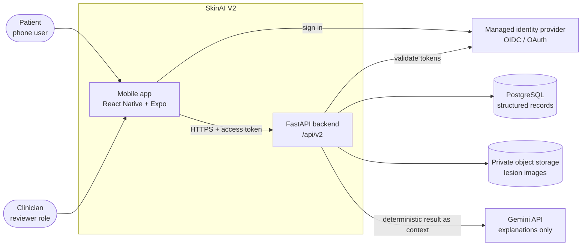

---

## 2. Layered architecture (modular monolith)

One deployable FastAPI app with internal layers. Intelligence code lives in the
top-level `intelligence/` package so it can be tested without the web layer.

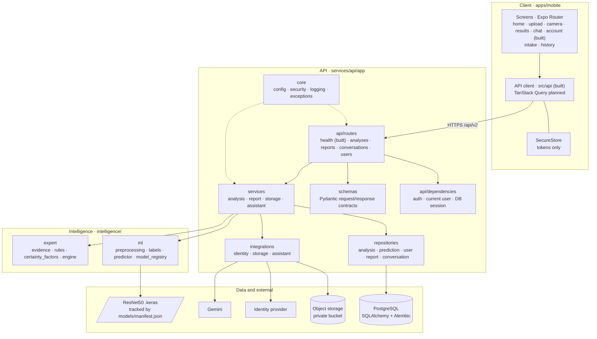

---

## 3. Analysis request: `POST /api/v2/analyses`

The main flow, including the image quality gate and where Gemini is allowed to
act. First release runs this synchronously inside the request.

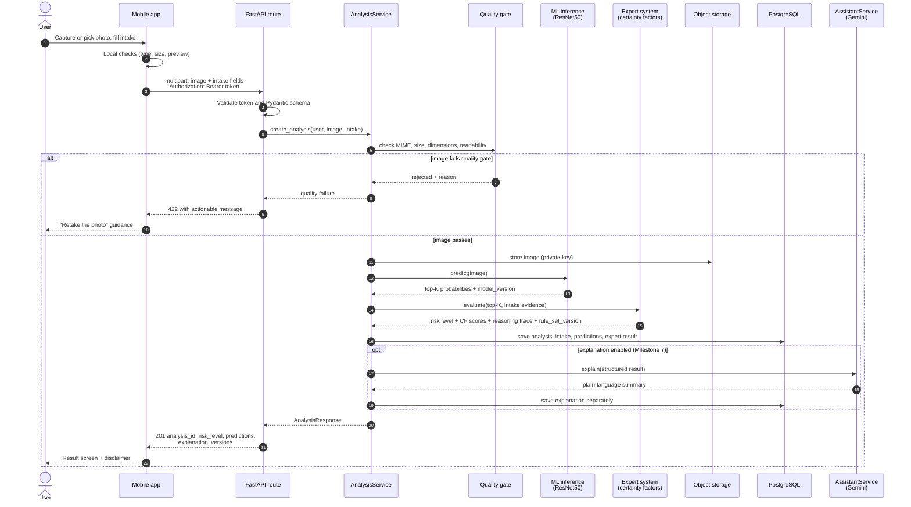

---

## 4. Decision boundary

Only the deterministic path decides the risk level. The LLM is downstream and
cannot change it.

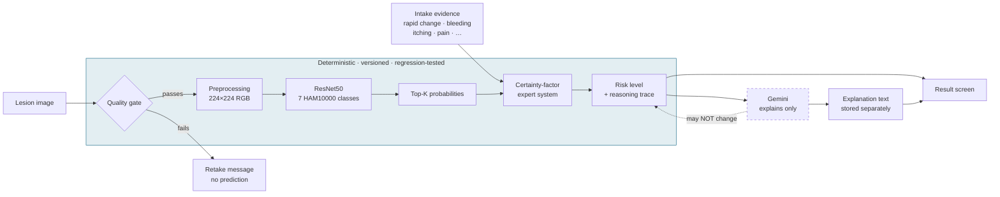

---

## 5. Data model

From the brief's "Recommended Data Model". UUIDs for every externally visible
ID; images live in object storage and are referenced by key.

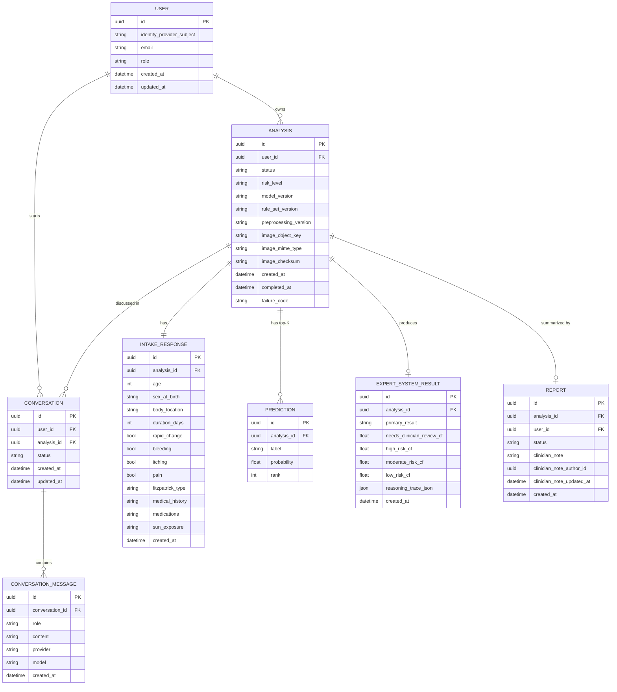

---

## 6. Sign-in and authorization

Managed OIDC sign-in; the server is the only place roles and ownership are
enforced. The provider is not chosen yet (Auth0, Firebase, Cognito, Entra
External ID or Supabase are all candidates).

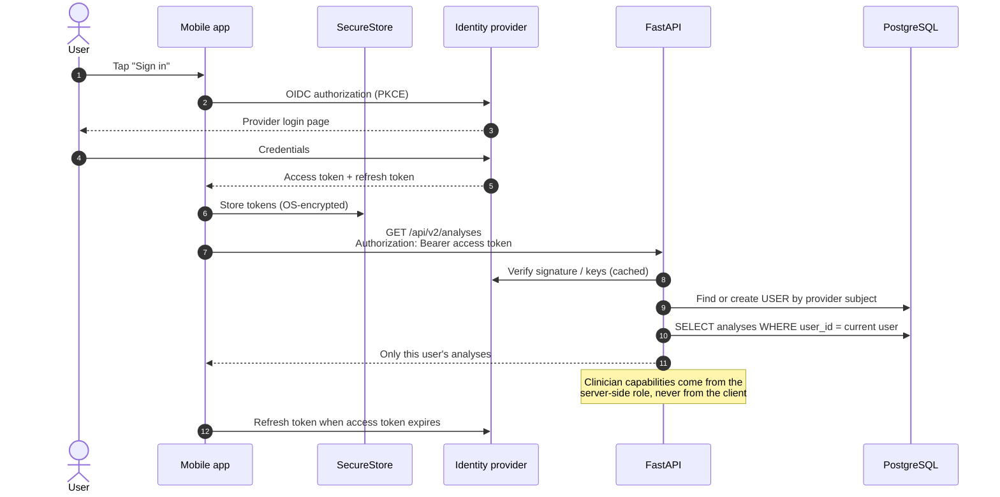

---

## 7. Image storage and access

Images never go into ordinary database columns and are never public.

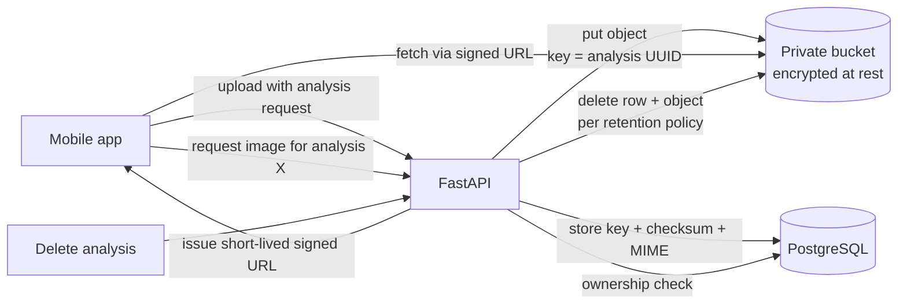

---

## 8. Inference: now and later

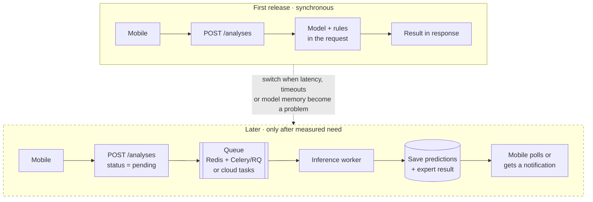

---

## 9. Mobile app structure

Current routes and features. "(built)" marks what exists today; dashed lines
are planned. How current routes map to the target routes is in
`REPOSITORY_STRUCTURE.md` under `apps/mobile/src/app/`.

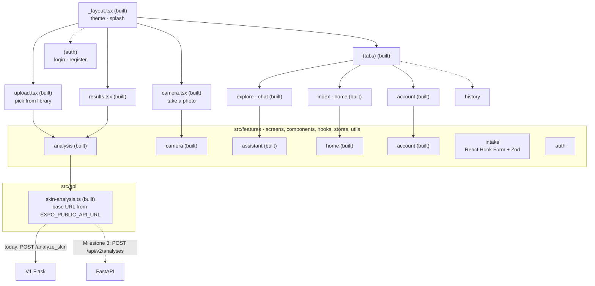

---

## 10. V1 → V2 migration map

What each V1 piece becomes. V1 code stays read-only under `legacy/`.

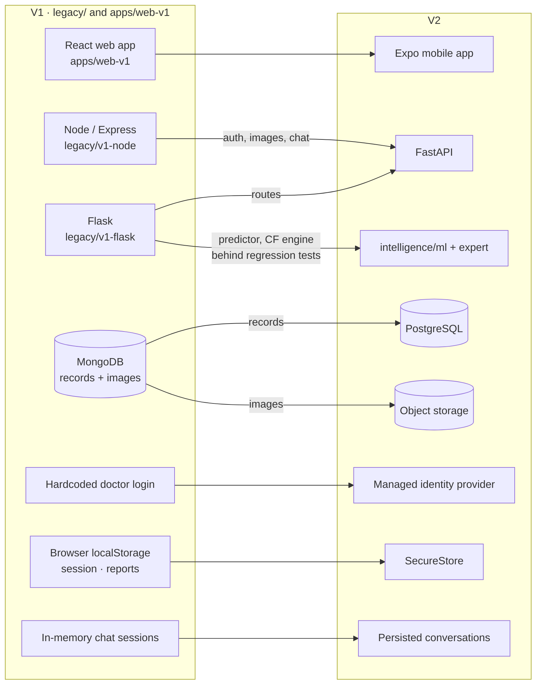

---

## 11. Implementation status

What exists today versus the plan in
[`docs/v2/IMPLEMENTATION_PLAN.md`](../v2/IMPLEMENTATION_PLAN.md). Update this
diagram when a milestone step lands.

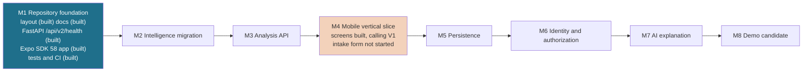
